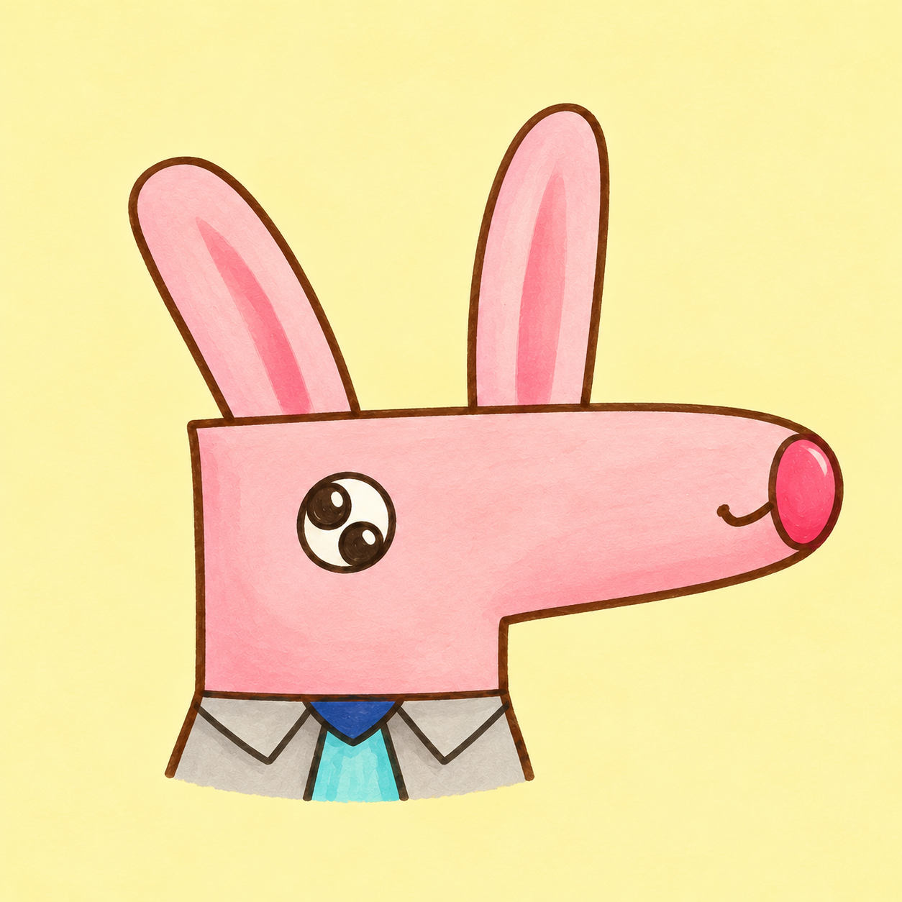
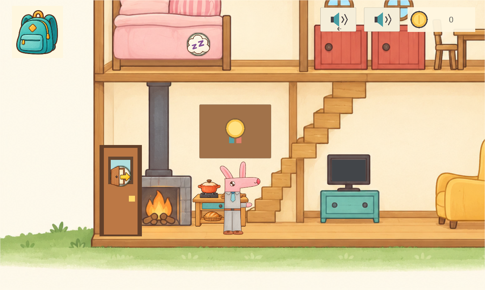
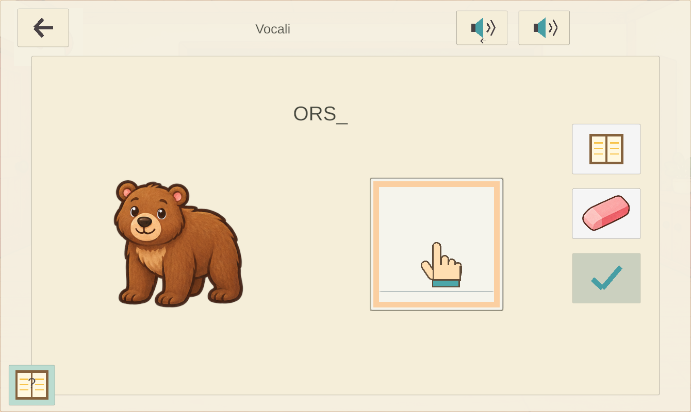
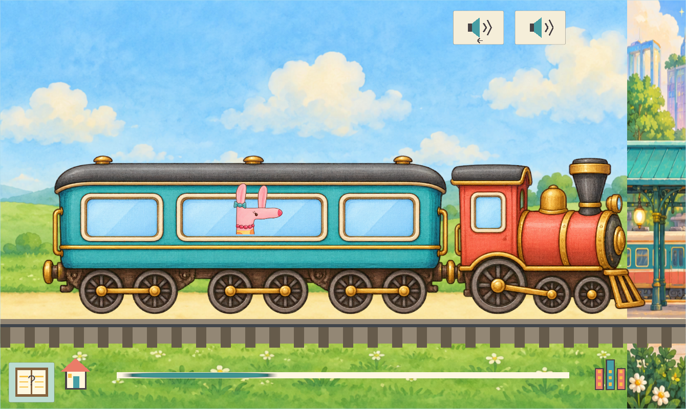

<div align="center">
  
  <h1>Mr Rabbit</h1>
  <p><strong>Un piccolo mondo da esplorare. La scuola al centro dell'avventura.</strong></p>
  <p>Un gioco educativo illustrato in italiano per bambini di 6–8 anni, realizzato con Unity.</p>
  <p>
    <a href="ProjectSettings/ProjectVersion.txt"></a>
    <a href="ProjectSettings/ProjectSettings.asset"></a>
    
    
    <a href="https://github.com/AntoCanza/mr-rabbit/actions/workflows/repository-checks.yml"></a>
  </p>
  <p><a href="#primi-passi">Primi passi</a> · <a href="#nel-gioco">Il gioco</a> · <a href="#struttura-del-repository">Struttura del repository</a> · <a href="docs/ARCHITECTURE.md">Architettura</a> · <a href="CONTRIBUTING.md">Come contribuire</a></p>
</div>



## La scuola è il fulcro del gioco

**Mr Rabbit segue il programma scolastico italiano della prima elementare (classe prima della scuola primaria). La scuola è il fulcro dell'esperienza e dell'avanzamento nel gioco.** Le attività accompagnano il bambino nell'apprendimento della lettura, della scrittura e dei primi concetti matematici, con esercizi brevi e variati, pratica e piccole verifiche da affrontare al proprio ritmo.

Il percorso attualmente disponibile propone competenze selezionate di **italiano e matematica**: vocali, suoni delle lettere, scrittura, sillabe, parole, brevi consegne da leggere, conteggio, sequenze numeriche e addizioni. Il riferimento alla prima elementare orienta contenuti e progressione; la versione attuale non comprende ancora tutte le materie e tutti gli obiettivi del programma. Le sottrazioni sono volutamente escluse.

Scegli Mr Rabbit o Miss Rabbit ed entra in un mondo accogliente, nato da disegni originali. Visita le amiche, coltiva l'orto, cucina a casa e prendi il treno per la città. **Queste attività sostengono il percorso scolastico:** le competenze apprese a scuola fanno guadagnare medaglie e sbloccano ricompense da usare nel resto del mondo, come nuove colture, vestiti e decorazioni per la casa.

Il gioco è pensato per tablet in orizzontale e per bambini che stanno imparando a leggere. Disegni riconoscibili, indicazioni animate e una voce italiana calma aiutano a capire il passo successivo. Il bambino può esplorare con i propri tempi, riascoltare una spiegazione o mettere in pausa la guida.

**Versione attuale dei sorgenti: 0.10.1, codice versione Android 18.** Il repository contiene il progetto Unity e gli strumenti di sviluppo. La cronologia conserva le precedenti verifiche delle compilazioni e sui dispositivi; la pubblicazione dei sorgenti non costituisce una nuova versione del gioco.

## Nel gioco

| Luogo o attività | Cosa può fare il bambino |
| --- | --- |
| **Scuola** | Esercitarsi con vocali, suoni delle lettere, scrittura a mano, sillabe, parole, brevi consegne, conteggio, sequenze numeriche e addizioni. Conquistare undici medaglie attraverso la pratica e piccole verifiche. |
| **Casa** | Spostarsi tra i piani, appendere e riordinare le medaglie conquistate, cucinare gli ingredienti raccolti, mangiare, guardare la TV e riposare al piano superiore. |
| **Campagna** | Esplorare un paesaggio continuo, scegliere scarpe o pattini, osservare il giorno e la notte e visitare Zebrella e Coccodella. |
| **Orto** | Preparare il terreno, scegliere i semi, seminare, annaffiare e raccogliere. Le ricompense scolastiche sbloccano nuove colture. |
| **Treno e città** | Andare in città, accettare richieste di prodotti, consegnare i raccolti in cambio di monete e comprare vestiti. |
| **Guida di Elsa** | Seguire un'introduzione illustrata riprendibile e suggerimenti vocali contestuali. Riascoltare, silenziare, sospendere o saltare la guida senza perdere i progressi conquistati. |

<table>
  <tr>
    <td width="50%"></td>
    <td width="50%"></td>
  </tr>
  <tr>
    <td align="center"><em>Scrivere, ascoltare e imparare con brevi attività.</em></td>
    <td align="center"><em>Esplorare un mondo legato alle ricompense scolastiche.</em></td>
  </tr>
</table>

Il riconoscimento della scrittura funziona localmente. I risultati delle prove sintetiche di regressione non misurano l'accuratezza sulla scrittura di bambini reali.

## Primi passi

### Requisiti

- **Unity Hub** e **Unity Editor 6000.3.25f1**, come indicato in [ProjectVersion.txt](ProjectSettings/ProjectVersion.txt).
- **Git** per clonare il progetto. Le risorse attuali sono archiviate direttamente in Git; Git LFS non è necessario.
- Per Android: installare **Android Build Support**, con SDK, NDK e OpenJDK, per questa versione dell'Editor tramite Unity Hub.

### Aprire il progetto e giocare

```sh
git clone https://github.com/AntoCanza/mr-rabbit.git
cd mr-rabbit
```

1. In Unity Hub scegliere **Add project from disk** e selezionare la cartella clonata `mr-rabbit`, che è la radice del progetto Unity.
2. Aprirla con **6000.3.25f1**. Attendere il ripristino dei pacchetti e l'importazione delle risorse; il primo avvio può richiedere diversi minuti.
3. Aprire **`Assets/Scenes/Home.unity`** e premere **Play**.
4. Seguire o saltare l'introduzione, scegliere un coniglio ed esplorare. Il libro illustrato di aiuto permette di riaprire la guida.

**Home** è l'unica scena di gioco abilitata nella compilazione. La scena di esempio e i modelli di scena sono conservati. Python e Unity CLI sono strumenti di sviluppo facoltativi: non servono per aprire il progetto o giocare.

### Comandi

| Interazione | Azione |
| --- | --- |
| **Trascinare su una zona libera dello sfondo** | Muoversi nella direzione del dito o del mouse, continuare a tenere premuto per camminare e rilasciare per fermarsi. Un piccolo movimento opposto inverte la direzione. |
| **Toccare un'azione illustrata** | Usare una porta, interagire con un'amica o un'attività, scegliere un oggetto o usare i comandi di un esercizio. |
| **Frecce della tastiera nell'Editor** | Camminare a destra e a sinistra; usare su e giù vicino ai pianerottoli per cambiare piano. |
| **Dito o mouse nell'area di scrittura** | Disegnare la lettera o il numero richiesto, poi confermare con il segno di spunta. |
| **Comandi dell'altoparlante e della guida** | Riascoltare la voce, salvare la preferenza audio, rivedere l'introduzione o sospendere i suggerimenti contestuali. |

## Struttura del repository

La radice del repository coincide con quella del progetto Unity e segue le [convenzioni delle cartelle di progetto di Unity](https://docs.unity.com/en-us/engine/6000.3/manual/get-started/project-configuration/default-directories).

```text
mr-rabbit/
├── Assets/                     # Contenuti del gioco e relativi file .meta
│   ├── Art/                    # Personaggi, casa, scuola, orto, città e campagna
│   ├── Audio/Italian/          # Narrazione italiana inclusa per l'ascolto offline
│   ├── Scenes/Home.unity       # Scena iniziale e scena abilitata nella compilazione
│   ├── Scripts/                # Gioco, apprendimento, comandi, salvataggi e interfaccia
│   ├── Settings/               # Renderer URP 2D e configurazione degli input
│   ├── Screenshots/            # Schermate già presenti nel progetto
│   └── TextMesh Pro/           # Risorse di testo importate e relative note
├── Packages/                   # manifest.json e packages-lock.json
├── ProjectSettings/            # Versione dell'Editor e configurazione Unity condivisa
├── AgentScripts/               # Automazione dell'Editor, verifiche e preparazione vocale facoltative
├── ArtSources/                 # Disegni originali, prompt e provenienza della voce
├── docs/                       # Avvio, architettura, verifiche, cronologia e immagini del README
├── tools/                      # Controllo dell'integrità del repository
├── .github/                    # Controlli del repository e modelli per i contributi
├── .gitattributes              # Terminatori di riga e gestione dei file binari
├── .gitignore                  # Cache Unity, risultati, acquisizioni e segreti locali esclusi
├── .editorconfig               # Impostazioni di formattazione condivise
├── AGENTS.md                   # Vincoli di gioco, documentazione e rilascio
└── CONTRIBUTING.md             # Indicazioni per contribuire e revisionare
```

`Assets`, `Packages` e `ProjectSettings` sono versionati insieme. I file `.meta` conservano i GUID e i riferimenti delle risorse Unity. Le cartelle generate `Library`, `Temp`, `Logs`, `UserSettings`, i progetti per gli IDE, i pacchetti compilati e le acquisizioni massive delle verifiche restano locali. Le tre immagini del README sono copie selezionate di schermate della versione 0.10.0.

## Tecnologie e convenzioni

- **C# / Unity 6**, **URP 2D**, **uGUI**, **TextMesh Pro** e **Input System**.
- **Visible Meta Files** e serializzazione **Force Text** sono già abilitati.
- Le versioni dei pacchetti sono fissate in [manifest.json](Packages/manifest.json) e [packages-lock.json](Packages/packages-lock.json).
- Gli script eseguiti nel gioco si trovano in `Assets/Scripts`, principalmente nel namespace `MrRabbit`. Gli strumenti per l'Editor restano fuori da `Assets` e dalle compilazioni del gioco.
- Chiavi locali `PlayerPrefs` versionate conservano i progressi. Gli aggiornamenti devono preservare monete, oggetti posseduti, colture, medaglie e guida incompleta.
- La guida italiana usa registrazioni incluse di **it-IT-ElsaNeural**. Durante il gioco non servono generazione vocale online o microfono.
- Tutta la documentazione del progetto, comprese guide, cronologia, note di rilascio e modelli per i contributi, deve essere scritta in **italiano**. Nomi di file, identificatori tecnici e diciture dei comandi Unity mantengono la forma necessaria al loro utilizzo.

Consultare [Architettura](docs/ARCHITECTURE.md) per i sistemi principali e [Risorse grafiche e audio](docs/ASSETS_AND_AUDIO.md) per la provenienza dei materiali e la preparazione vocale facoltativa.

## Compilare per Android

1. Aprire **File → Build Profiles**, selezionare Android e cambiare piattaforma attiva se necessario.
2. Verificare che `Assets/Scenes/Home.unity` sia abilitata nell'elenco delle scene.
3. Controllare le impostazioni del lettore: identificatore **`com.mrrabbit.home`**, orientamento orizzontale, **IL2CPP** e **ARM64**. L'API Android minima è **25**; quella di destinazione è fissata a **36** (Android 16).
4. Generare un APK locale in **`Builds/Android/`**, con un nome che includa la versione, per esempio `MrRabbit-0.10.1.apk`.

Chiavi di firma e password restano fuori da Git. La distribuzione sugli store richiede una configurazione separata per firma e pubblicazione. Per iOS servono macOS, Xcode e la firma Apple; qui non viene dichiarato alcun rilascio iOS.

Leggere [Configurazione e compilazione](docs/GETTING_STARTED.md) prima di preparare una versione distribuibile e seguire tutti i [requisiti di verifica del rilascio](docs/VERIFICATION.md).

## Controlli e contributi

```sh
python tools/check_repository.py
```

Il flusso GitHub di controllo del repository esegue lo stesso controllo leggero a ogni invio e richiesta di integrazione. Verifica metadati e GUID delle risorse, versioni dei pacchetti, scena da compilare ed esclusione dei risultati locali. Non compila Unity, non esegue il gioco e non certifica un rilascio. Gli strumenti esistenti `AgentScripts/Verify*.cs` offrono verifiche nell'Editor per singole funzionalità.

I contributi devono mantenere centrale l'apprendimento scolastico, preservare i salvataggi e rendere le interazioni comprensibili ai bambini di 6–8 anni. Partire da [Come contribuire](CONTRIBUTING.md) e dalle [istruzioni per gli agenti](AGENTS.md).

## Documentazione

| Guida | Contenuto |
| --- | --- |
| [Configurazione e compilazione](docs/GETTING_STARTED.md) | Prima importazione, configurazione Android e risoluzione dei problemi |
| [Architettura](docs/ARCHITECTURE.md) | Sistemi di gioco, organizzazione della scena e progressi salvati |
| [Risorse grafiche e audio](docs/ASSETS_AND_AUDIO.md) | Disegni, illustrazioni generate, narrazione offline e materiali di terzi |
| [Verifiche](docs/VERIFICATION.md) | Controlli del repository, prove delle funzionalità, tutela dei salvataggi e requisiti di rilascio |
| [Cronologia dello sviluppo](docs/DEVELOPMENT_HISTORY.md) | Note di implementazione conservate ed evidenze dei rilasci precedenti |

## Pubblicazione su Google Play

La pubblicazione è prevista come gioco **gratuito, senza pubblicità né acquisti in-app**, con nome sviluppatore **SofiaAntonio Games** e contatto pubblico **antoniocanza@gmail.com**. Il gioco non è ancora disponibile su Google Play: l'account sviluppatore deve essere creato e l'iter di test e revisione deve essere completato.

La versione 0.10.1 aggiunge l'informativa privacy offline, accessibile da **Per i genitori · Privacy** nella scelta del personaggio. Il manifesto Android rimuove i permessi di rete e disabilita il backup dei salvataggi, che restano sul dispositivo.

Consultare la [preparazione della pubblicazione](docs/PUBBLICAZIONE_GOOGLE_PLAY.md), la [scheda italiana dello store](docs/SCHEDA_GOOGLE_PLAY_IT.md) e il [testo dell'informativa](Assets/Resources/InformativaPrivacy.txt).

## Crediti e licenze

Mr Rabbit nasce da disegni originali, trasformati in risorse illustrate per il gioco; i prompt sorgente sono conservati in `ArtSources`. La narrazione italiana viene sintetizzata durante lo sviluppo e inclusa per l'ascolto offline. Pacchetti Unity, risorse TextMesh Pro, caratteri tipografici e altri materiali di terzi conservano le rispettive licenze e note.

Non è stata scelta una licenza generale di riutilizzo del progetto. La disponibilità pubblica non concede automaticamente una nuova licenza su codice originale, disegni, illustrazioni, personaggi o narrazione. Consultare [Risorse grafiche e audio](docs/ASSETS_AND_AUDIO.md) per provenienza e note conservate.
